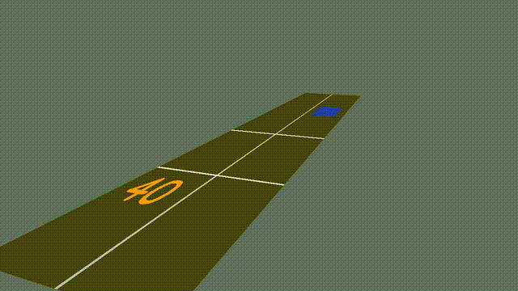
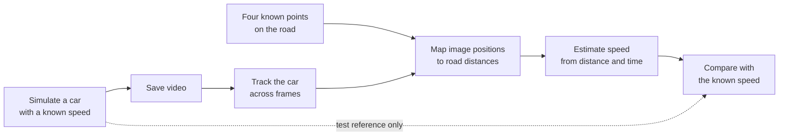

# Camera Speed Estimation

Can video from a fixed camera be used to estimate a vehicle's speed? This
project starts by testing the calculation on a **simulated** road, where the
car's actual speed is known.



*Synthetic example: a car approaching at 60 km/h on a left-hand-traffic road,
viewed from a camera 5.5 m above the road. The blue rectangle is a simplified
car, not real footage.*

## How it works



The estimator reads the video and road-point calibration, **not** the
simulated speed. The road is 6 m wide; the camera height is an assumption,
not a surveyed installation height.

### Example results

| Simulated speed | Estimated from video |
| --- | --- |
| 40 km/h | 40.06 km/h |
| 60 km/h | 60.15 km/h |

These are example results under ideal, synthetic conditions, **not evidence
of real-world accuracy** or reliable identification of speeding vehicles.

## Setup

Python 3.10 or later is required. Install the dependencies in a virtual
environment:

```shell
python -m venv .venv
```

Activate the virtual environment using the appropriate command for your
platform, then run:

```shell
python -m pip install -r requirements.txt
```

## Run the experiment

```shell
python speed_demo.py simulate --speed 60 --output output/car-60.mp4 --calibration output/calibration.json
python speed_demo.py estimate --video output/car-60.mp4 --calibration output/calibration.json
python -m unittest discover -s tests
```

Repeat with `--speed 40` and a different output filename to compare the
results. The simulation reports its input speed; the estimator reads only
the video and calibration. The reported speed is a linear fit to positions
over time. Video files and the output directory are ignored by Git.

## Scope and limitations

The car is a flat, blue rectangle on a flat road; its color enables a simple
detector. This is not a realistic vehicle detector or a test of performance
on real footage. Calibration uses ideal point correspondences from the
simulator, and timestamps are derived from the constant video frame rate.
Camera placement, field of view, vehicle shape and lighting are illustrative.
The simulation does not establish real-world accuracy or prove that a
60 km/h threshold can be reliably enforced. Near any threshold, uncertainty
must be considered and ambiguous cases left unclassified.

Future work could test calibration and tracking on actual footage with
independently measured distances and speeds, accounting for camera distortion,
timestamps, occlusion and privacy. Do not commit real footage or other
identifying material to this public repository.
